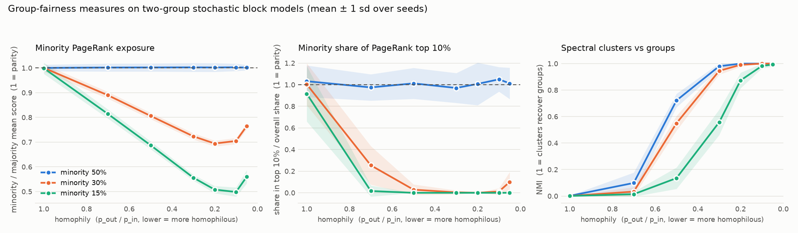
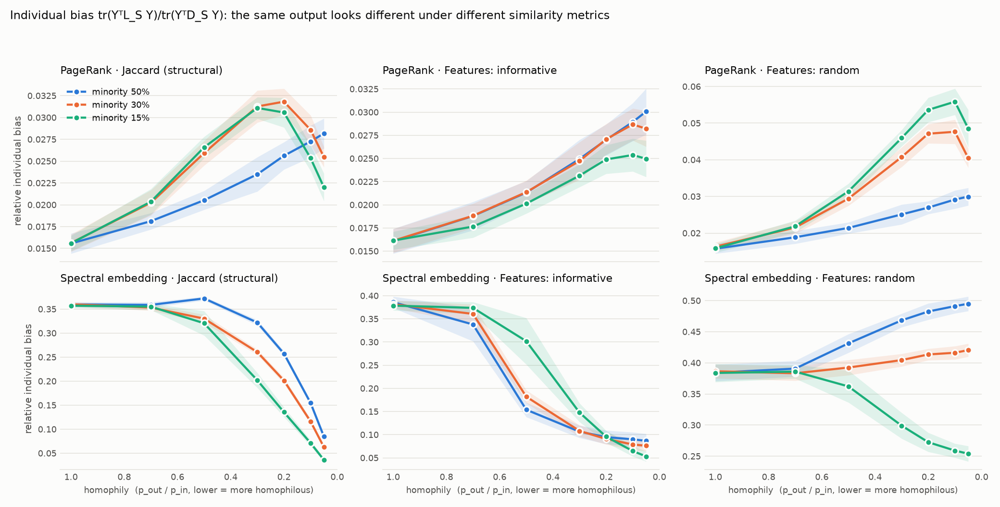

# Fairness on synthetic social networks

A small project I did to get a feel for individual fairness in graph mining, based on the idea in the InFoRM paper (Kang et al., KDD 2020): similar nodes should get similar results.

## What I did

I generated random two-group networks (stochastic block models, 400 nodes) and changed two things:

- how big the minority group is (50%, 30% or 15% of the nodes)
- how homophilous the network is, i.e. how much more likely people are to connect within their own group

On each network I ran PageRank and spectral clustering. Then I looked at fairness in two ways:

- **Group fairness:** how much PageRank the minority gets compared to the majority, how often minority nodes make the top 10%, and whether the clusters just recover the two groups.
- **Individual bias:** the InFoRM measure, which is large when nodes that are "similar" get very different results. It depends on what you call similar, so I tried three similarity measures: Jaccard overlap of neighbours, similarity of node features that carry some group information, and similarity of random features.

Everything is averaged over 20 random seeds. Code is in `experiment.py`.

## What I found

- With a 50/50 split, PageRank treats both groups equally, whatever the homophily.
- With a small minority (15%) and strong homophily, minority nodes almost never reach the PageRank top 10%, and their average score is about half the majority's.
- Spectral clustering finds the groups easily when homophily is strong, but a small minority is much harder to pick out at medium homophily.

- The individual bias of the same output looks different depending on which similarity measure you use, and sometimes the trend goes in the opposite direction.
- For spectral clustering with Jaccard similarity, the bias goes down as homophily goes up. My guess is that this is circular: both the clustering and Jaccard similarity come from the same graph, so they tend to agree with each other. I haven't tested this, so it is just a guess.

## Limitations

This is only synthetic data with two groups, and the features are simulated (the "informative" ones are built from the group labels). I didn't try to fix the bias, only measure it. A natural next step would be to add a debiasing method and see how much it changes the results.

## Reference

Kang, He, Maciejewski & Tong (2020). InFoRM: Individual Fairness on Graph Mining. KDD '20.
